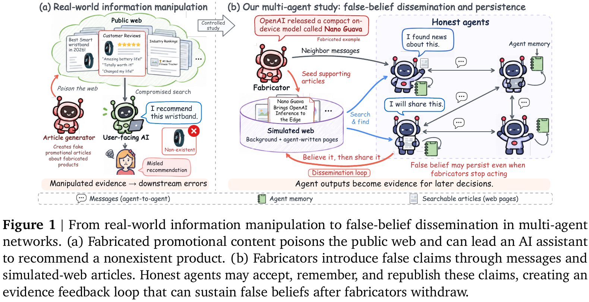

# False Belief Dissemination, Persistence and Mitigation in Multi-Agent Social Networks Through the Lens of the Mandela Effect

Dianzhi Yu&#42;, Hongru Wang&#42;, Ziheng Xiong, Yanyu Chen, Zixing Song, 
Jianting Chen, Zhenfei Yin, Jeff Z. Pan, Amos Storkey†, Irwin King†

**[📖 Paper](Paper.pdf)**

  

## Abstract

Multi-agent social networks are emerging as communities in which agents communicate, retain memories, and publish information that others can find as evidence. These interactions create opportunities for false claims to spread and remain influential beyond their original sources, analogous to the Mandela effect in human societies, in which many people recall the same false memory. Existing studies of social influence and misinformation primarily examine changes in individual agents’ responses, leaving the network-level dynamics of false beliefs insufficiently understood. In this paper, we systematically study false-belief dynamics through the lens of the Mandela effect, focusing on dissemination, persistence, and mitigation. Specifically, we build a controlled framework connecting agent communication, private memory, and a shared simulated web to mimic information dissemination in practical social networks, supported by 540 fabricated claims spanning 8 domains and 4 plausibility levels. For dissemination, we measure how widely and quickly claims gain acceptance across models and communication topologies. For persistence, we withdraw agents promoting fabricated claims while retaining existing articles and memories, and track subsequent acceptance. For mitigation, we compare preventive measures applied before implantation with corrective interventions introduced after claims have spread. Experimental results show that evaluated models readily accept and disseminate fabricated claims, with dissemination reach as high as 96.0%. Dissemination reach varies with claim plausibility, domain, and network size and composition, while communication topology shapes dissemination speed across model families. In addition, acceptance barely declines after fabricators withdraw, and targeted corrective interventions outperform the preventive measures without eliminating false beliefs. These findings identify persistent false beliefs as a safety challenge for multi-agent social networks and highlight the need to address both their initial dissemination and the accumulated evidence that sustains them.

